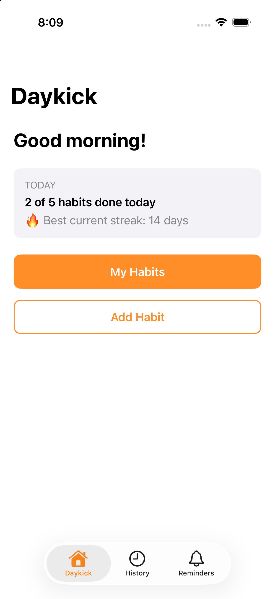
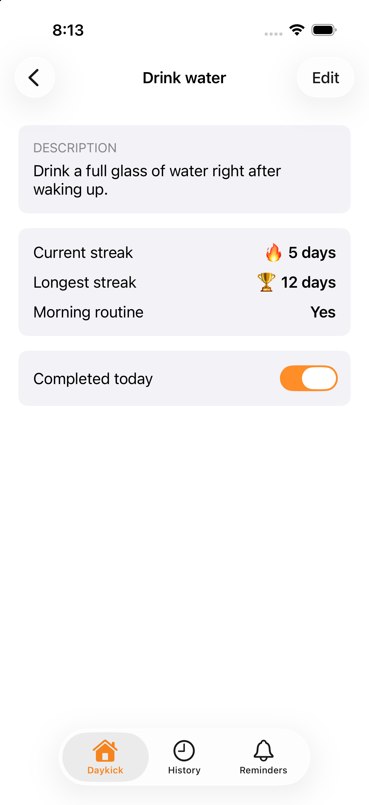
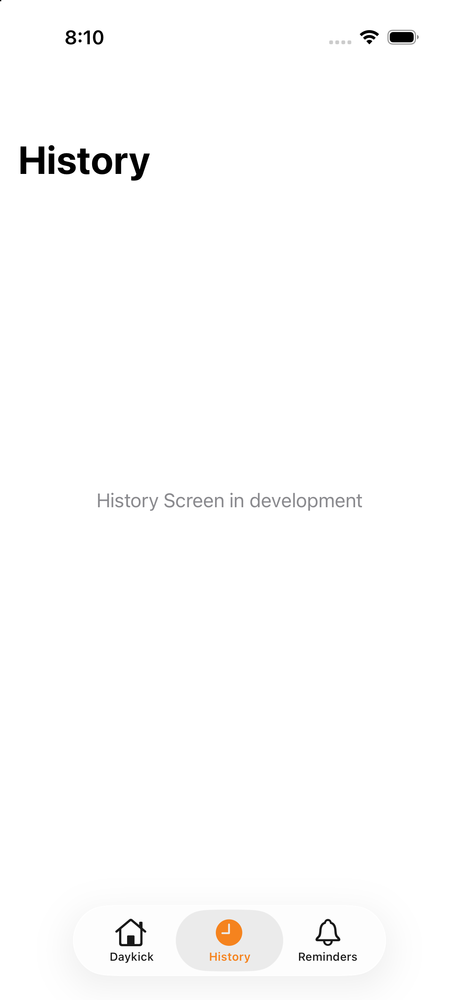
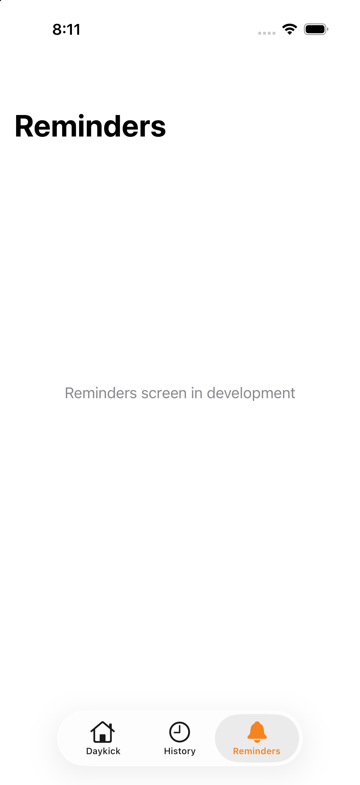

# DayKick

CPSC 411 Final Project. A daily habit tracker for iOS built with UIKit.

## Team
- Omar Arias
- Kevin Lim

## Application Description
Daykick is a daily habit-tracking app that helps people build consistent routines, especially in the morning. Users create daily habits such as "drink water" or "read for 20 minutes," check them off each day, and watch their streaks grow. Each habit keeps its own current and longest streak, so users can see how consistent they've been and stay motivated not to break the chain. Daykick is for students and anyone who wants a simple way to build better habits and start the day organized. Later milestones add saved data, a History screen, reminders, notifications and AI-assisted habit and reminder creation.

## Milestone 1: UIKit UI

Built with programmatic UIKit (Option B): every screen is a Swift file, Auto Layout anchors pinned to the safe area, UIStackView for layout, UITableView for the habit list, and a UINavigationController for navigation. Data is hard-coded sample data (`Models/Habit.swift`).

The app launches into a `UITabBarController` with three tabs — **Home**, **History**, **Reminders** — each wrapped in its own `UINavigationController` (so every tab keeps its own top nav bar). 

### Screen List
1. **HomeViewController**: Entry screen. Shows today's progress (habits completed, best current streak) and buttons to view all habits or add a new one.
2. **HabitListViewController**: A table of all habits with today's completion status and current streak. Tapping a row opens its detail; the + button adds a habit.
3. **HabitDetailViewController**: Details for one habit: description, current and longest streak, whether it's part of the morning routine, and a switch to mark it completed today. The Edit button opens the edit form.
4. **AddEditHabitViewController**: A form to create a new habit or edit an existing one (name, description, start day, morning-routine switch, Save).
5. **HistoryViewController**: Placeholder for the History screen 
6. **RemindersViewController**: Placeholder for the Reminders screen 

### Screen Navigation Diagram
```
            +-----------------------------------------+
            |         Tab Bar Controller              |
            |   Home  ·  History  ·  Reminders        |
            +-----------------------------------------+
                |             |             |
                v             v             v
          +----------+  +----------+  +-------------+
          |   Home   |  | History  |  |  Reminders  |   
          +----------+  +----------+  +-------------+
                |             
                |               
                v             
          +--------------+   +--------------+
          |  My Habits   |-->| Habit Detail | 
          +--------------+   +--------------+
                 |
                 | 
                 v
          +--------------+
          |   Add Habit  |
          +--------------+
                 |
                 | 
                 v
          +--------------+
          |  Edit Habit  |   
          +--------------+
```

### Screenshots
Taken in the iPhone 17 Pro simulator.

| Home | Habit List | Habit Detail |
|:---:|:---:|:---:|
|  |  |  |

| Add/Edit Habit | History | Reminders |
|:---:|:---:|:---:|
|  |  |  |

## Project Structure
```
DayKick/
├── SceneDelegate.swift      Sets the root UITabBarController (Home / History / Reminders)
├── Models/Habit.swift       Habit struct + sample data          (shared)
├── Views/Theme.swift        Fonts, colors, spacing, buttons     (shared)
├── Controllers/
│   ├── HomeViewController.swift            Kevin
│   ├── HabitListViewController.swift       Kevin
│   ├── HabitDetailViewController.swift     Omar
│   ├── AddEditHabitViewController.swift    Omar
│   ├── HistoryViewController.swift         placeholder 
│   └── RemindersViewController.swift       placeholder 
└── Storyboards/             Just the launch screen SB, took programmatic UIKit route 
```


## Tech
- Swift
- UIKit (programmatic for Milestone 1; Storyboards kept for reference)
